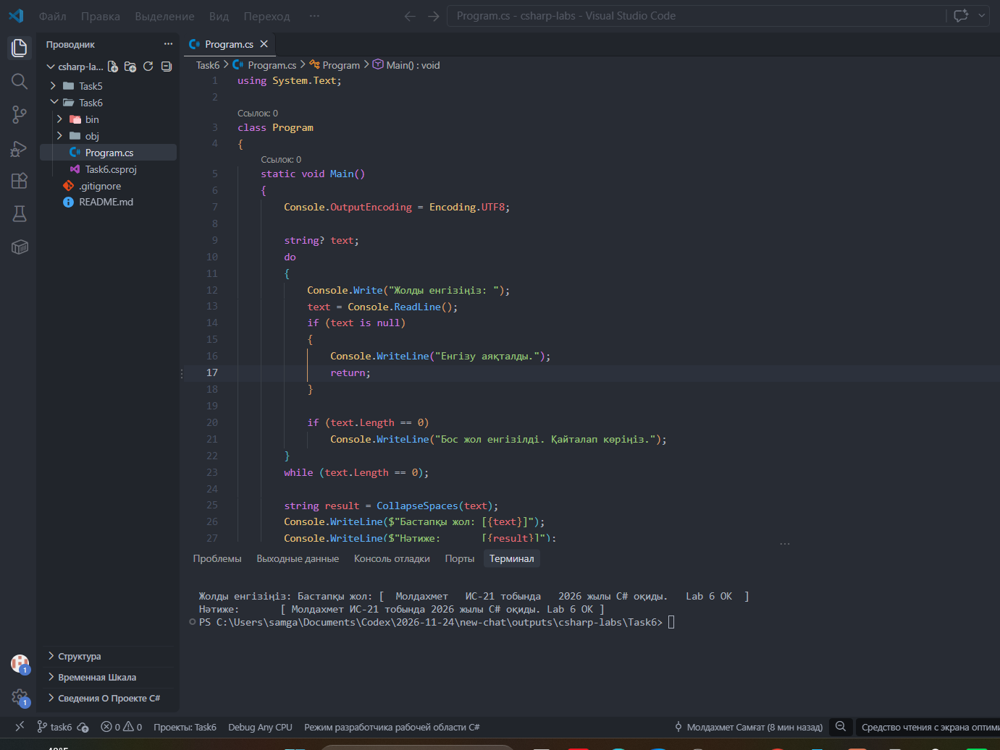

# 6-тапсырма. Символдар тіркесі (3-нұсқа)



## Тесттер

| Тест | Кіріс | Қолмен есептегенім | Бағдарлама нәтижесі |
|---|---|---|---|
| Жеке тест | `  Молдахмет   ИС-21 тобында   2026 жылы C# оқиды.   Lab 6 ОК  ` | ` Молдахмет ИС-21 тобында 2026 жылы C# оқиды. Lab 6 ОК ` | ` Молдахмет ИС-21 тобында 2026 жылы C# оқиды. Lab 6 ОК ` |
| Өз тестім 1 | `A  B   C` | `A B C` | `A B C` |
| Өз тестім 2 | `Қазақша   мәтін` | `Қазақша мәтін` | `Қазақша мәтін` |
| Бос енгізу | бос жол, кейін `  Сәлем   әлем  ` | бағдарлама қайта сұрайды; нәтиже: ` Сәлем әлем ` | бағдарлама қайта сұрады; нәтиже: ` Сәлем әлем ` |

Жеке тестті VS Code ішінде іске қостым. Қалған екі жолды және бос жол енгізілген жағдайды да тексердім.

## Сұрақтарға жауап

1. `text[i]` жолдағы `i` нөмірлі таңбаны береді. Оның типі — `char`. Жолды орнында өзгертуге болмайды, сондықтан `text[i] = 'a'` деп жаза алмаймыз.
2. `previousWasSpace` алдыңғы таңбаның бос орын болғанын сақтайды. Қатарынан бос орын келсе, біріншісі ғана нәтижеге қосылады. Басындағы және соңындағы бос орынның біреуі сақталады.
3. `result += ch` бастапқы `text` жолын өзгертпейді. Символ қосылған жаңа жол мәні жасалады.

## Кездескен қате

Алғашқыда бағдарламаны дайын `.exe` файлы ретінде ашқанда Windows Application Control оны бұғаттады. Кодта қате болған жоқ: VS Code терминалында `dotnet run` арқылы іске қосып, нәтижені тексердім. Бұл код қатесі болмағандықтан, түзету коммиті жоқ.

## Git

README коммитіне дейінгі `git log --oneline --graph --all` нәтижесі:

```text
* df2b3e9 Task6: collapse consecutive spaces with a loop
* 6ce287c Task6: add console project scaffold
*   f5cd7ef Merge pull request #1 from samgatbrein/task5
|\
| * 996835e Task5: бағдарлама нәтижесінің скриншоты қосылды
| * c32dac6 Task5: есеп пен сұрақтарға жауап қосылды
| * 5bdef78 Task5: матрицаны толтыру және шығару
| * d16ae2e Task5: матрицаны толтыру, шығару және нұсқа әдісі
|/
* 382819f Бастапқы README және gitignore қосылды
* 4795eb4 Initial commit
```

1. `task5` тармағын Pull Request арқылы `main`-ге біріктіріп, тармақты өшірмедік. `task6` тармағын `main`-нен ашып, жұмысты үш коммитке бөліп сақтадым. Соңында өзгерістерді `main`-ге біріктірдім.
2. `commit` өзгерісті компьютердегі Git тарихына сақтайды. `push` сол тарихты GitHub-қа жібереді. Push болмаса, мұғалім жаңа өзгерісті GitHub-та көрмейді.
3. `.gitignore` файлында `bin/` және `obj/` ережелері бар. Бұл қалталарда жоба құрастырғанда қайта жасалатын файлдар тұрады.

## ЖИ қолдану

Сұрауым: «PDF-тегі 6-зертхананың 3-нұсқасын орындап, есепті дайында». Кодқа `CollapseSpaces` әдісін циклмен жазу және алдыңғы таңбаны `previousWasSpace` айнымалысымен тексеру кірді. Жеке тест пен қосымша мысалдарда нәтижесін тексердім.
